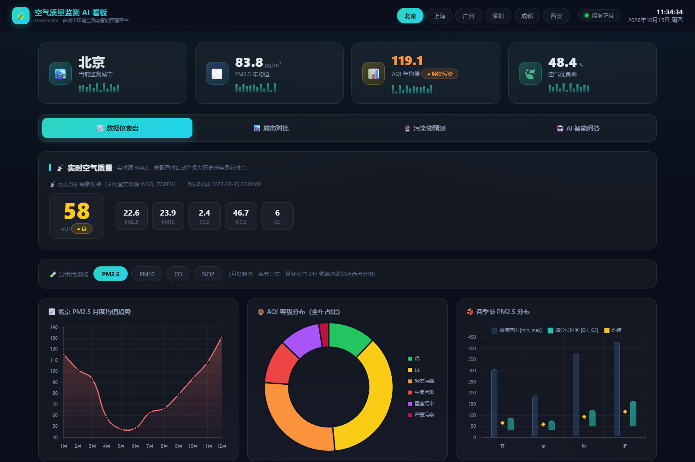

# AirQuality Multi-City RAG Agent

[](https://github.com/MimiQuark/AirQuality-Multi-City-RAG-Agent/actions/workflows/ci.yml)
[](https://github.com/MimiQuark/AirQuality-Multi-City-RAG-Agent)
[](https://www.python.org/)
[](https://fastapi.tiangolo.com/)
[](https://langchain-ai.github.io/langgraph/)
[](LICENSE)

多城市空气质量分析与预警 Agent：FastAPI + LangGraph 编排 10 个领域工具，结合混合检索、可校准拒答、规则降级、24 小时预测和评测集。没有 LLM Key 时自动使用确定性规则 Agent，适合本地演示和自动化回归。

<p align="center">
  
</p>

> 数据仪表盘：六城市切换、实时空气质量、月度趋势、AQI 等级分布与季节对比

## 架构

```text
FastAPI /api
   ├── /api/chat/agent      LangGraph LLM 编排（无 Key 时规则 Agent）
   ├── /api/chat            传统问答兼容
   ├── /api/realtime        实时数据（WAQI，可选）
   ├── /api/report/daily    每日日报（日期白名单 + 生成鉴权）
   └── /api/rag/*           混合检索 / 重建索引

agents/         LLM JSON 工具规划 + 规则 Agent + 综合回答
tools/          10 个领域工具（实时、预测、对比、季节、相关性、告警、训练、政策）
rag/            NumPy 内存混合检索 + 离线 hash / BGE Embedding + 拒答
engine.py       数据加载、特征、模型、告警、季节/相关性
evaluation/     RAG、工具路由、端到端基准
```

## 能力

- 10 个领域工具：实时/历史数据、24 小时预测、城市对比、季节、相关性、预警、模型训练与政策检索。
- 混合检索：内存向量索引 + 词法召回；支持离线 hash Embedding 和可选 BGE 中文 Embedding。
- **LLM JSON 工具规划**（不是原生 Function Calling）：模型输出 JSON 调用计划，由代码解析并执行；规则 Agent 是可离线回归的降级路径。
- 引用来源、低置信度拒答、SQLite Trace、反馈收集和 60 条工具路由回归集。
- 两套检索评测集：v1 简单集（110 条，题面照抄标题，仅作回归护栏）与 v2 困难集（66 条口语化提问）。
- 平衡拒答集 48 条（24 条超纲应拒 + 24 条领域内应答）。

## 评测结果（按口径阅读）

### 检索 / 拒答

**BGE 语义模型 + 结构分块，v2 困难集（历史手工运行）：**

| 检索指标 | 数值 |
|---|---:|
| Recall@1 | 0.773 |
| Recall@5 | 0.985 |
| MRR | 0.862 |
| 拒答准确率 | 0.896（应拒 0.958 / 应答 0.833） |

同一套集上离线 hash 的 CI 回归基线为 Recall@1 0.500 / Recall@5 0.848 / 拒答准确率 0.562；它不是线上能力，只用于防止回归。

> 评测边界：拒答阈值 0.53 是在 48 条拒答集**全量**上选择的，仓库没有实现训练/留出拆分；48 条拒答查询中有 21 条与 66 条检索查询重叠，拒答独立性有限。BGE 结果来自手工运行，CI 默认跑离线 hash。

### 端到端（规则版，修正口径后）

24 个用例中，18 个可评路由/事实的领域用例；OOD 用例不送分，空 `must_mention` 不计事实通过，伪造条款计入引用错误。

| 指标 | 规则版 |
|---|---:|
| 工具路由正确率 | 0.611（11/18） |
| 事实要点覆盖率 | 0.444（8/18） |
| 引用正确率（文本） | 0.750 |
| 拒答合规率 | 0.750 |
| 拒答—引用一致性 | 1.000 |
| 幻觉引用数 / 总引用 | 0 / 22（编造条款 0） |
| API 层结构化引用正确率 | 0.750 |
| API 层结构化幻觉引用 | 0 |

LLM 版历史单次运行（glm-4-flash）不作为当前可复现结论；它需要 API Key，未按新口径重跑。工具路由的 60/60 是**规则版确定性回归集**，不是 LLM 准确率。

## 快速开始

环境：Python 3.11–3.12（`pyproject.toml` 声明 `<3.14`）。

```bash
python -m venv .venv
source .venv/bin/activate            # Windows: .venv\Scripts\activate
python -m pip install -e ".[dev]"
USE_REAL_EMBEDDINGS=0 uvicorn backend.main:app --reload
```

可选：真实 BGE Embedding

```bash
python -m pip install -e ".[rag]"
USE_REAL_EMBEDDINGS=1 EMBEDDING_MODEL=BAAI/bge-small-zh-v1.5 uvicorn backend.main:app
```

`.env` 现在会被 `python-dotenv` 自动加载；Docker Compose 也会读取它。不要把真实 Key 提交到仓库。

## 评测命令

```bash
python -m backend.evaluation.eval_agent             # 60 条规则工具路由回归
python -m backend.evaluation.eval_rag               # 离线 hash 检索/拒答 guardrail
python -m backend.evaluation.eval_rag --all --sweep # 两套集 + 阈值扫描
python -m backend.evaluation.eval_e2e --answerer rule
python scripts/record_checks.py --coverage-fail-under 70
```

`reports/`、`backend/evaluation/eval_result.json` 是运行产物，已被 gitignore；CI 会重新生成并上传 artifact。

## 测试

```bash
python -m pytest -q
```

当前 20 项测试，覆盖 RAG、健康检查、日报路径校验、Agent 降级、规则 Agent 分支、预测特征无泄漏和实时工具数据传递。CI 使用 Python 3.11，先做 editable + wheel 安装门禁，再跑测试、工具路由回归和覆盖率检查。

## 相关文档

| 文档 | 内容 |
|---|---|
| [docs/WORKLOG.md](docs/WORKLOG.md) | 工作记录与提交时间线 |
| [docs/RAG_EVAL_REPORT.md](docs/RAG_EVAL_REPORT.md) | 检索/拒答评测与消融 |
| [docs/CODE_AUDIT.md](docs/CODE_AUDIT.md) | 代码与数据审查 |
| [docs/CASE_STUDY.md](docs/CASE_STUDY.md) | Agent 设计与评测方法 |

## 已知局限

- 检索是**进程内 NumPy 索引**，不是 PostgreSQL/pgvector；数据量扩大后需要真正的向量库。
- LLM 规划是 JSON 计划解析，不是原生 Function Calling。
- 24 小时标准阈值与单小时浓度的比较仍属于筛查口径；生产使用应改为滚动 24 小时均值或明确分级。
- 拒答集与检索集存在重叠，阈值未做训练/留出拆分；不要把它当成独立泛化指标。
- 分块策略的收益没有在仓库中提供可复现的 bootstrap 显著性检验。
- 预测模型已移除滚动特征的当前行泄漏并在评估后全量重训；历史 R²/recall 数字不再作为承诺。
- LLM 输出非确定性，历史单次 E2E 结果不作为当前可复现指标。
- 日报接口已校验日期和路径，生成接口需要 `ADMIN_API_TOKEN`；`/api/traces` 等调试接口在生产部署前需要加鉴权。

## License

MIT。见 [LICENSE](LICENSE)。
